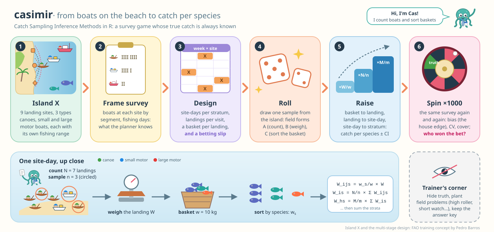

# casimir 

**Catch Sampling Inference Methods in R**

**Guide and documentation: <https://henning-winker.github.io/casimir/>**
([How it works](https://henning-winker.github.io/casimir/articles/casimir-00-how-it-works.html) ·
[User guide](https://henning-winker.github.io/casimir/articles/casimir-02-user-guide.html) ·
[Teaching cards](https://henning-winker.github.io/casimir/articles/casimir-03-teaching.html) ·
[Functions](https://henning-winker.github.io/casimir/reference/index.html))

casimir is a catch estimator simulator for training in landing-site surveys
(catch assessment surveys). It simulates a small-scale fishery whose true
landings are known, and lets trainees **design** a stratified multi-stage
survey, **roll** a sample, **raise** it to catch per species with the
estimators of the FAO training, and **spin** the design many times to see its
bias, precision and cost. It is made for **trainees** (estimate a catch whose
truth is known) and for **trainers** (plant field problems, keep the answer
key).

The fishery comes from the logbook simulator of
[cpueTargeting](https://github.com/Henning-Winker/cpueTargeting) with its
landing-site layer: landing sites, segments with fishing ranges, and a
calendar. The teaching style follows
[FLOSS](https://github.com/Henning-Winker/FLOSS).



## Concept

```
1 ISLAND        ->  2 FRAME        ->  3 DESIGN            ->  4 ROLL          ->  5 RAISE            ->  6 SPIN x1000
sites, segments,    boats by site,     site-days (PSUs),       field forms         landing, site-day,     bias, CV,
ranges; the true    fishing days       landings, subsample;    A, B, C             stratum, total;        coverage, cost
landings                               betting slip            (+ artefacts)       intervals
```

* **Island X.** Nine landing sites of three types (Harbour, Beach, Jetty)
  and three segments (canoe, small motor, large motor) with different
  ranges, home tactics and sites, from the training deck.
* **Design.** Strata are site type x quarter (segments within each visit);
  the PSU is a site-day; landings per segment; species subsamples in baskets.
* **Estimators.** `W_ijs = w_ijs / w_ij * W_ij`, `W_is = N_i / n_i * sum W_ijs`,
  `W_hs = M_h / m_h * sum W_is`, with the ultimate-cluster variance, and the
  CPUE x effort route. Unbiased over replicates; a census recovers the truth.
* **Planted artefacts.** High roller, short watch, easy sites, dropped zeros,
  top of the box, old frame.
* **Engine first.** Everything runs from R scripts; the Shiny app only
  collects inputs and calls the same functions.

## Installation

```r
# install.packages("remotes")
remotes::install_github("Henning-Winker/cpueTargeting@landing-sites")
remotes::install_github("Henning-Winker/casimir")
```

## The app

```r
install.packages(c("shiny", "shinydashboard", "commonmark"))
casimir::run_app()
```

The app has the layout of the FLOSS app: numbered steps in the left panel,
sub-tabs on each page, a *Before you roll* checklist with the **Build
island** and **Roll** buttons, and the **Hide truth** switch.

| Step | Sub-tabs |
|---|---|
| Guide | Start here, Island and frame, Design and field forms, Raising, Spin, Warning flags, Cash out and truth, Settings explained |
| 1 Island | Fleet and ranges, Map, Landings |
| 2 Frame survey | Boats by site, Fishing days |
| 3 Design | Stages, Costs, Betting slip |
| 4 Roll | Visits (week x site grid), Form A, Form B, Form C, Artefacts (trainer) |
| 5 Raise | Step by step, Totals |
| 6 Spin x1000 | Spin, Results, Betting slip |
| 7 Cash out | survey files, with the answer key for trainers |
| True catch | Estimate vs truth, By stratum, Planted artefacts (only with Hide truth unticked) |

## Quick start

```r
library(casimir)
fish <- cas_fishery(island_x(), seed = 1)       # the island and its true landings
d    <- cas_design(m = 6, n = 3, w_kg = 10)      # 6 site-days per site type and quarter
s    <- draw_sample(fish, d, seed = 2)           # field forms A-C
e    <- estimate_catch(s)                        # catch per species with intervals
check_estimate(e, fish)                          # against the truth
ev   <- replicate_design(fish, d, R = 200)       # Spin: bias, CV, coverage
plot_eval(ev)
```

## Authors

Henning Winker and Pedro Barros (FAO). Island X and the multi-stage sampling
design follow the FAO training concept by Pedro Barros (*Data Collection and
Estimation of Fisheries Quantities: estimating catch per species and catch
per size group*).
